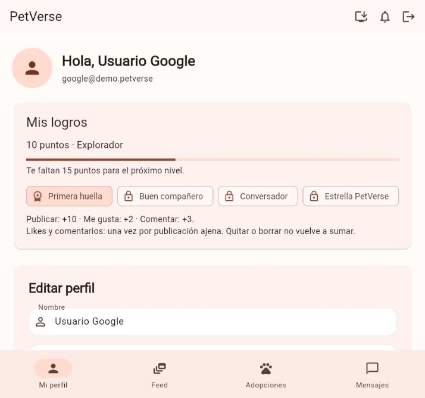
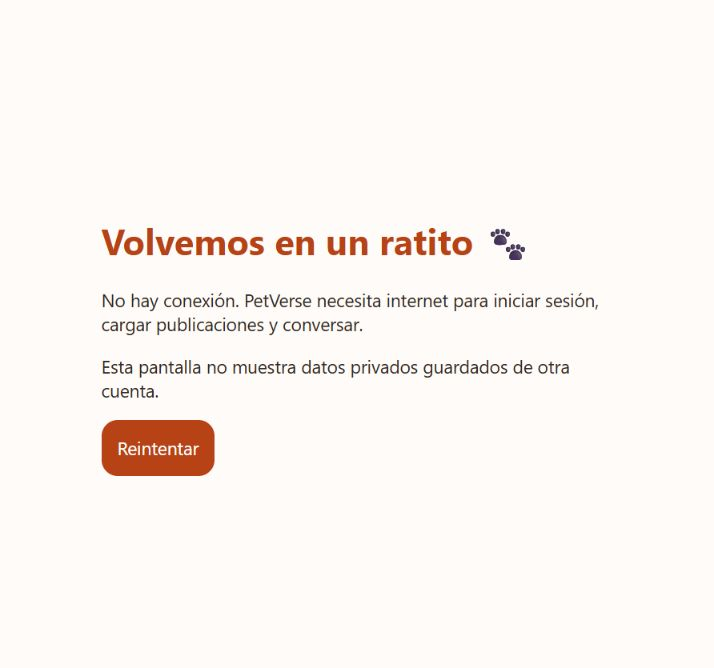

# PV11 a PV14

## Estado verificado

PV11, PV12 y PV13 están implementados y probados localmente. Para PV14 están
preparados el build y Firebase Hosting; falta autenticar la herramienta de Firebase
para poder publicar y verificar una URL pública. No confundir una configuración
de despliegue con una publicación exitosa. No se usó Vercel ni se activó Blaze.

## Antes de usar Firebase real: actualizar reglas

Copiar el contenido completo de `firestore.rules` a **Firebase > Firestore >
Reglas > Publicar**. Este cambio es necesario para publicar, dar like y comentar:
el crédito de gamificación se guarda de forma atómica junto con la acción.
No hay que crear colecciones manualmente.

## PV11: puntos, niveles e insignias

| Acción | Puntos | Condición |
| --- | ---: | --- |
| Publicar | 10 | Publicación nueva y mascota propia |
| Dar like | 2 | Una vez por publicación ajena |
| Comentar | 3 | Primer comentario en cada publicación ajena |

La consigna no fija importes: se eligieron estos valores como regla del producto.
Quitar/reponer likes o borrar/recrear comentarios no vuelve a sumar. Likes y
comentarios propios no conceden puntos. Los créditos obtenidos no se descuentan
cuando se borra un comentario; las insignias son logros permanentes.

Los créditos se guardan en `users/{uid}/activity/{kind}_{postId}` y solo pueden
crearse una vez. No existe un contador editable `points` en el perfil. Las reglas
comprueban el propietario, la fuente real, la fecha del servidor y los campos
admitidos. Las transacciones resuelven acciones concurrentes entre pestañas.

Niveles: Explorador (0), Amigo (25), Embajador (100), Leyenda (250).
Insignias: Primera huella (una publicación), Buen compañero (5 likes a
publicaciones ajenas distintas), Conversador (5 publicaciones ajenas comentadas)
y Estrella PetVerse (100 puntos). Las condiciones aparecen al mantener el cursor
o pulsación prolongada sobre cada insignia.

El historial empieza con las acciones realizadas por esta versión. No se hizo
una migración masiva de publicaciones o comentarios antiguos. Un like antiguo
puede acreditarse una única vez al volver a interactuar con él.

## PV12: instalar y usar la PWA

- Manifest con nombre, ID, scope, arranque standalone e iconos PNG 192/512.
- Iconos maskable separados y recurso de inicio para Safari móvil.
- Botón Instalar PetVerse tanto en acceso como en la barra de la aplicación.
- Chrome/Edge ofrecen el prompt si el navegador lo considera disponible.
  Si no está disponible se muestran instrucciones; no se simula una instalación.
- Aceptar el prompt no marca la app como instalada hasta recibir `appinstalled`
  o ejecutar en modo standalone.
- El worker `app-sw.js` usa scope raíz; FCM conserva su scope específico.
  `flutter_bootstrap.js` omite el worker legado de Flutter para evitar reemplazos.
- El worker cachea solo manifest, iconos, ayuda y recursos estáticos permitidos.
  No cachea Auth, Firestore, chats, fotos/videos de usuarios ni respuestas API.
  Si se corta la conexión al navegar, muestra una página offline explícita.
  No se promete que el feed o la mensajería funcionen sin internet.
- Cada build publicado recibe un hash de versión. Los recursos usan revalidación
  HTTP y el worker nuevo espera a que se cierren pestañas antiguas antes de activarse.

Para comprobar instalación real, abrir la URL HTTPS publicada en Chrome/Edge
(no incógnito ni navegador integrado) y usar Instalar PetVerse. En Safari móvil,
Compartir > Agregar a pantalla de inicio. El navegador puede aplicar condiciones
adicionales; la aplicación no puede forzar ese diálogo.

Referencias: [manifest](https://web.dev/learn/pwa/web-app-manifest),
[prompt de instalación](https://web.dev/learn/pwa/installation-prompt),
[worker en Flutter](https://docs.flutter.dev/platform-integration/web/faq).

## PV13: comportamiento por pantalla

Se verificaron acceso, perfil, mascota, publicación, adopciones y chat en:

| Tamaño | Comportamiento |
| --- | --- |
| 320 x 740 | Una columna, formularios apilados y barra inferior compacta |
| 768 x 1024 | Contenido centrado, grillas según espacio y barra inferior |
| 1440 x 900 | Navegación lateral extendida y contenido con ancho máximo |

Los formularios pueden desplazarse. No se achica toda la aplicación como una
imagen ni se bloquea el zoom del navegador. Textos largos usan ajuste de línea
o elipsis cuando corresponde; los botones esenciales siguen accesibles.

## PV14: Firebase Hosting, sin Vercel

Se eligió Hosting estático, no Firebase App Hosting. El proyecto destino es
`petverse-29db2`; el sitio configurado debe pertenecer a ese proyecto.
No ejecutar un deploy general: también intentaría desplegar servicios que siguen
sin activar. El script publica únicamente Hosting y no modifica las reglas.

### Autenticar la herramienta

Desde la carpeta del proyecto:

```powershell
firebase login
```

Si no existe el comando global, se puede usar la copia local ya instalada:

```powershell
node .\test\firestore\node_modules\firebase-tools\lib\bin\firebase.js login
```

Si tampoco existe esa copia, ejecutar `npm ci` dentro de `test/firestore` con
Node compatible. El usuario debe completar el acceso en el navegador; no
compartir contraseñas, códigos OAuth ni tokens en el chat o el repositorio.

### Compilar y publicar

```powershell
.\scripts\publish.ps1
.\scripts\publish.ps1 -Deploy
```

El primer comando solo compila y verifica. El segundo recompila y publica solo
Hosting. Se necesitan `flutter` y `node` disponibles; el script usa Firebase CLI
global o su copia local. Cada ejecución crea automáticamente una copia temporal
fuera de OneDrive y compila allí, sin reutilizar `build/web` del proyecto original.
El despliegue se realiza desde esa copia. La ruta queda indicada en la terminal.
No se borran ni se mueven los archivos originales. La validación comprueba que
manifest, workers e iconos correspondan a las fuentes actuales antes de publicar.
El script indica una ruta de salida absoluta mediante `--output`, incluso si
Flutter tiene configurado otro directorio de compilación a nivel del usuario.

Equivalente manual:

```powershell
flutter build web --release --dart-define-from-file=config/firebase.local.json --output build/web
node scripts/prepare_web.mjs build/web
node .\test\firestore\node_modules\firebase-tools\lib\bin\firebase.js deploy --project petverse-29db2 --only hosting
```

Hosting usa HTTPS y puede utilizarse dentro de las cuotas de Spark.
[Documentación oficial](https://firebase.google.com/docs/hosting/quickstart).
No se habilitó facturación, Functions ni Storage como parte del despliegue.

Cuando se confirme la publicación, tomar la URL que devuelve Firebase CLI y:

1. Verificar HTTP exitoso y acceso a manifest, iconos, worker y build-info.
2. Probar email y Google; comprobar el dominio en Authentication > Configuración
   > Dominios autorizados. Agregarlo si Firebase lo requiere.
3. Crear una publicación, reaccionar/comentar desde otra cuenta y revisar logros.
4. Instalar desde un navegador compatible y abrirla en ventana independiente.
5. Verificar modo offline sin mostrar datos de otra cuenta.

La dirección esperada del sitio por defecto no es evidencia de un despliegue:
solo debe anunciarse como URL de entrega después de comprobar estos pasos.

## Pruebas y evidencia

```powershell
flutter analyze
flutter test
node --test test/web/pwa.test.cjs
cd test/firestore
npm test
```

Se comprobaron créditos, niveles, aislamiento de sesión, instalación aceptada/
cancelada, iconos, workers y diseños. La prueba visual en una demo local confirmó
10 puntos y la primera insignia al publicar. Deteniendo el servidor de esa demo
y recargando se confirmó la página offline servida por el worker.




